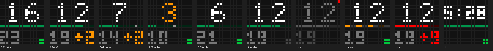
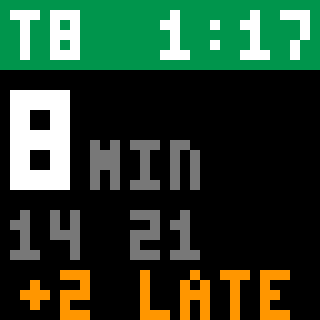

# Display service

An always-on service for one display:

- **Clock**, set up automatically whenever the display connects, so it comes back by itself after a power cut instead of starting blank.
- **Sleep hours**: the screen turns off and on on a schedule.
- **Morning train board**: live departures from Transport for NSW (the same data TripView uses) during a time window, then back to the clock.

### 16x16 board



- **Big number**: minutes until the next train you can catch. Turns amber in the last 3 minutes before you need to leave. An hour or more away, it shows the departure time instead.
- **Divider**: one lit dot per minute until you need to leave, so it shrinks as the train gets closer. A grey dot marks the following train once that's within 16 minutes, and red dots mark cancelled trains where they would have been. Cancelled trains are left out of the countdown.
  - **Dashed amber**: trackwork on the line right now.
  - **Red**: major disruption (high-priority alert, or suspended, cancelled or not running services).
- **Bottom left**: minutes until the following train.
- **Bottom right**: `+N` when the next train is N minutes late (amber, red from 5). Otherwise a 2x2 dot: **green** = live tracking says it's on time, **dim grey** = timetable only, no live position yet.
- **Greyed out with a red corner dot**: departures couldn't be refreshed, so these are the last known numbers. After 5 minutes it switches to `NO DATA`.

With `WALK_MINUTES` set, trains you can't reach in time are hidden and the divider counts down to when you need to leave rather than to departure.

### 32x32 board



The line and current time, minutes until the next train (large), the two after it, and whether it's running late.

It holds a Bluetooth connection open, which is how it notices a power cut straight away. The display only takes one connection at a time, so **stop the service before using the phone app** (`docker compose stop`).

## Where to run it

Anywhere with Bluetooth that's within range of the display (roughly one room):

- **A Raspberry Pi** with built-in Bluetooth (3B+, 4, Zero 2 W).
- **A Proxmox VM** with a USB Bluetooth dongle passed through (Hardware → Add → USB Device, then shut the VM down and start it again). Install `bluez` in the VM and check `bluetoothctl show`.
  **Not an LXC**: the kernel only allows Bluetooth sockets in the host's network namespace, so the dongle can't be used from inside a container.

## Setup

The steps below are for a Pi, but any Debian-based machine with Docker (including an OpenMediaVault VM) works the same way from step 2.

1. Install Raspberry Pi OS Lite (64-bit) and Docker:

   ```sh
   curl -fsSL https://get.docker.com | sh
   sudo usermod -aG docker $USER   # log out and back in
   ```

2. Check Bluetooth is up: `bluetoothctl show` should print a controller with `Powered: yes`.

3. Clone this repo, then:

   ```sh
   cp .env.example .env
   docker compose build
   docker compose run --rm idotmatrix scan        # prints the display's address
   ```

   Close the phone app first, otherwise the display is busy and won't show up. Put the address in `IDM_ADDRESS` in `.env`.

4. Get a free API key at <https://opendata.transport.nsw.gov.au>: sign up, create an application and add the **Trip Planner APIs**. Put the key in `TFNSW_API_KEY`, then check the stop and platform:

   ```sh
   docker compose run --rm idotmatrix stops "Central Station"   # your station; put its ID in STOP_ID
   docker compose run --rm idotmatrix departures
   ```

   `departures` should list the trains from your platform. If it's empty, run it with `PLATFORM=` in `.env` to see what the platforms are called.

   `docker compose run --rm idotmatrix alerts` lists today's alerts for your stop and line, how each was classified (`trackwork`, `major` or `info`, which is ignored), and whether it's in effect now.

5. Start it:

   ```sh
   docker compose up -d
   docker compose logs -f
   ```

   `restart: unless-stopped` brings it back after the Pi reboots.

## Settings

All in `.env`. See [.env.example](../.env.example) for every option. After changing them, run `docker compose up -d` to apply.

To try a layout without the display, `docker compose run --rm -v $PWD:/out idotmatrix preview /out/preview.png` renders the board using live data if a key is set, otherwise sample trains.

## Troubleshooting

- **Screen stays dark although the logs say `sent clock`**: usually the display's own sleep schedule from the phone app, which blanks the screen whatever is sent. The service now turns it off on every connect, so use `SLEEP` instead. If it ever comes back, turn the schedule off in the app.
- **Nothing happens at all**: `docker compose stop`, then `docker compose run --rm idotmatrix test` shows red and green using the two Bluetooth write types and logs the display's replies (`05 00 .. .. 01` means the command was accepted). Set `WRITE_WITH_RESPONSE` to whichever one worked.
- **`display not reachable` forever**: the phone app is probably connected. Force-close it. Also check the Pi is close enough.
- **D-Bus permission errors**: on hosts with AppArmor (Ubuntu), add `security_opt: [apparmor:unconfined]` to the compose service.
- **Board says `NO DATA`**: the API hasn't answered for 5 minutes. `docker compose logs` shows why (a wrong key gives a 401).
